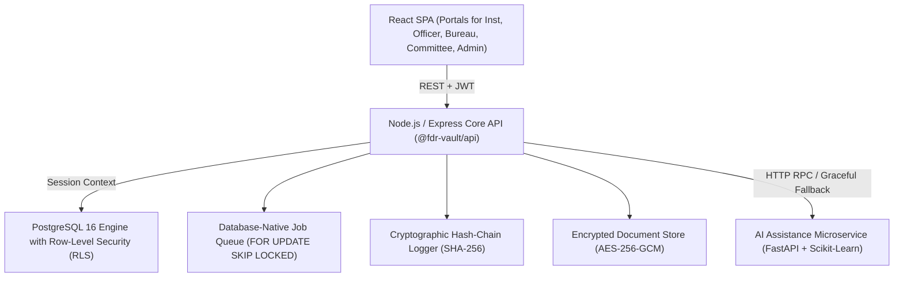

# ASTRA: Automated Security Deposit Tracking, Reconciliation & Audit Vault

[](https://www.sih.gov.in/)
[](https://www.aicte-india.org/)
[](LICENSE)
[](backend/test)
[](docs/AUDIT_CHAIN.md)

**Problem Statement SIH26265**: Streamline Security Deposit / Fixed Deposit Receipt (FDR) Portal & Smart Automation  
**Organization**: All India Council for Technical Education (AICTE), Ministry of Education, Government of India  
**Team**: Nocturnals  
**Repository**: [https://github.com/saran612/ASTRA.git](https://github.com/saran612/ASTRA.git)

---

## 1. Executive Overview

ASTRA (Automated Security deposit Tracking, Reconciliation & Audit) is an enterprise digital compliance platform purpose-built for the AICTE Regulation Bureau. It automates the end-to-end statutory lifecycle of mandatory institutional security deposits, fixed deposit receipts, and bank guarantees across 10,000+ technical education institutions in India.

### Core Architectural Principles:
1. **Zero-Trust Field Provenance**: Field-level tri-state ledger (`INSTITUTION` ➔ `OFFICER_ENTERED` ➔ `BANK_CONFIRMED`) distinguishing raw claims from bank-verified ground truth.
2. **Cryptographic Immutability**: Append-only SHA-256 recursive hash chain ensuring instant mathematical detection of unauthorized database tampering or intermediate row deletion.
3. **Statutory Gating & Honesty**: Enforced two-tier approval gates (RO 5-point checklist + Bureau Authority sanction), business-day obligation ladders, and rule-grounded AI assistance that rejects unverified hallucinations.



---

## 2. Complete Documentation Portal (14 Deliverables)

All architectural, security, mathematical, and regulatory specifications are maintained under [`docs/`](docs/):

| Document | Description |
| :--- | :--- |
| **[docs/ARCHITECTURE.md](docs/ARCHITECTURE.md)** | Monorepo layout, C4 container diagram, component boundaries, RLS, job queue, and AI boundary. |
| **[docs/DATA_MODEL.md](docs/DATA_MODEL.md)** | Complete Entity-Relationship (ER) diagram, PostgreSQL tables, columns, indexes, and RLS policies. |
| **[docs/RULES.md](docs/RULES.md)** | Catalog of 8 automated compliance rules, thresholds, parameters, and APH handbook references. |
| **[docs/TRUST_MODEL.md](docs/TRUST_MODEL.md)** | Field-level provenance ledger, promotion lifecycles, and institutional tampering attack tree. |
| **[docs/AUDIT_CHAIN.md](docs/AUDIT_CHAIN.md)** | Mathematical specification of the SHA-256 recursive hash chain, verification algorithm, and tamper proofs. |
| **[docs/OBLIGATIONS.md](docs/OBLIGATIONS.md)** | Unified obligation engine, holiday calendar, alert ladder (T-90 to T-0), and `SKIP LOCKED` job queue. |
| **[docs/RUNBOOK.md](docs/RUNBOOK.md)** | Complete developer setup, environment variables, seeding, background workers, and troubleshooting. |
| **[docs/SECURITY.md](docs/SECURITY.md)** | Security architecture, 5-role RBAC matrix, PostgreSQL RLS policies, AES-256-GCM encryption, and threat model. |
| **[docs/API.md](docs/API.md)** | Comprehensive REST API reference covering Auth, FDRs, Discrepancies, Release, and Audit endpoints. |
| **[docs/ASSUMPTIONS.md](docs/ASSUMPTIONS.md)** | Regulatory defaults, banking reality, analytical baseline assumptions, and conflict precedence ledger. |
| **[docs/MODEL_CARD.md](docs/MODEL_CARD.md)** | Model card for SLA breach risk predictor and OCR token extraction with synthetic data disclaimer. |
| **[docs/EVAL_REPORT.md](docs/EVAL_REPORT.md)** | Measured empirical evaluation benchmark generated across 200 seeded FDRs and deliberate defect classes. |
| **[docs/CLAIMS_VS_REALITY.md](docs/CLAIMS_VS_REALITY.md)** | Honest retrospective contrasting pitch deck claims against actual working code implementation. |
| **[docs/STATUS.md](docs/STATUS.md)** | Final milestone delivery scorecard and automated test verification evidence. |

---

## 3. Quick-Start Guide (Clean Clone Setup)

### Prerequisites:
- **Node.js** `>= 20.10.0`
- **Docker & Docker Compose** (PostgreSQL on port `5434`, MailHog on port `1026`)
- **Python** `>= 3.12` (for AI assistance microservice)

### Step 1: Clone & Install Dependencies
```bash
git clone https://github.com/saran612/ASTRA.git
cd ASTRA
npm install
```

### Step 2: Spin Up Containers & Initialize Database
```bash
docker compose up -d
npm run db:push --workspace=backend
npm run db:rls --workspace=backend
npm run seed --workspace=backend
```
*Seeds 200 realistic FDR instruments across all 8 AICTE regions with deliberate edge cases.*

### Step 3: Start AI Microservice (Optional, but recommended)
```bash
cd services/ai
python3 -m venv venv
source venv/bin/activate
pip install -r requirements.txt
uvicorn main:app --host 127.0.0.1 --port 8000 --reload
```

### Step 4: Run Application Stack
```bash
# Terminal 1: Start Backend API (Port 4000)
npm run dev --workspace=backend

# Terminal 2: Start Frontend SPA (Port 5173)
npm run dev --workspace=frontend
```
Access the web portal at **`http://localhost:5173`**.

---

## 4. Test Suite & Verification Commands

```bash
# Run root monorepo test suite (14 test files, 90 passing tests)
npm test

# Run Python AI microservice test suite (5 passing tests)
cd services/ai && pytest && cd ../..

# Run automated evaluation benchmark (updates docs/EVAL_REPORT.md)
npm run eval

# Verify production build compilation across all workspaces
npm run build
```

---

## 5. Seeded Role Accounts Reference (Password: `Demo@123`)

| Role | Email ID | Region / Scope | Console View |
| :--- | :--- | :--- | :--- |
| **College Principal (Institution)** | `inst.north@aicte-demo.edu.in` | Northern Region (`1-10972341`) | FDR Submission, Renewal Lineage |
| **Regional Scrutiny Officer** | `officer.north@aicte-demo.gov.in` | Northern Jurisdiction | Scrutiny Queue, Trust Ledger, Bank Inquiry |
| **Bureau Authority** | `authority@aicte-demo.gov.in` | Pan-India | National Liquidity, 2-Tier Release Approval |
| **Committee Member** | `committee@aicte-demo.gov.in` | Pan-India | Statutory Hearing Agenda & Forfeitures |
| **Portal Administrator** | `admin@aicte-demo.gov.in` | Global | Cryptographic Audit Explorer, Time Travel |

---

## 6. Interactive Demo Walkthrough (7 Steps)

For an end-to-end guided evaluation, follow the step-by-step walkthrough in **[`docs/DEMO.md`](docs/DEMO.md)**:
1. **Submit FDR**: Submit a deposit as an Institution; observe initial amber `CLAIMED (INSTITUTION)` trust badges.
2. **Automated Scrutiny**: Log in as Regional Officer; inspect flagged discrepancy items (`DATE_INVALID`, `DUPLICATE_FDR_NO`).
3. **Bank Verification**: Generate AICTE bank inquiry letter; trigger mock confirmation; observe trust badges promote to teal `BANK_CONFIRMED`.
4. **Time Travel**: Advance system clock in Admin Console by 2 years and 10 months; run scan job; observe T-90 alert dispatch and status transition to `EXPIRING`.
5. **Renewal Linking**: Submit replacement FDR; observe predecessor link preserved in audit history.
6. **Two-Tier Release**: Sign off on 5-point checklist as RO; approve final refund authorization as Bureau Authority with statutory disclaimer.
7. **Forensic Audit Verification**: Open `/admin/audit`; verify 100% SHA-256 chain integrity; inspect tamper-detection breakpoint alerts.
