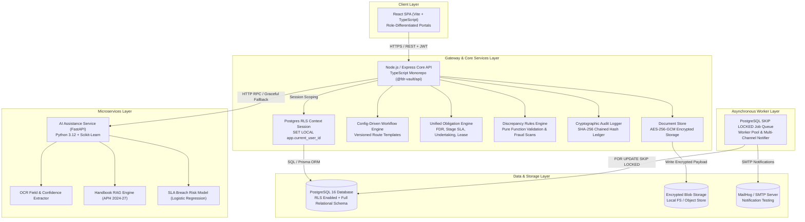
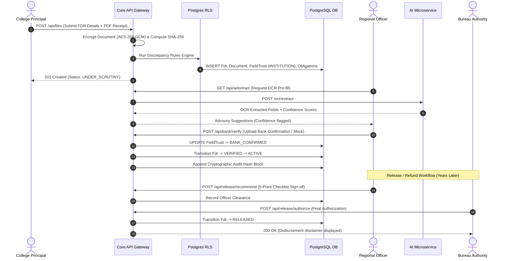

# ASTRA / FDR Vault — Architecture Specification

> **AICTE SIH26265**: Streamline Security Deposit / Fixed Deposit Receipt (FDR) Portal & Smart Automation  
> **Team**: Nocturnals  
> **Repository**: [https://github.com/saran612/ASTRA.git](https://github.com/saran612/ASTRA.git)

---

## 1. Executive Summary & Mission

The AICTE security deposit system requires apex-tier integrity, multi-stakeholder governance, and non-repudiable financial oversight across more than 10,000 technical education institutions in India. ASTRA (Automated Security deposit Tracking, Reconciliation & Audit) transforms a fragmented, paper-heavy compliance workflow into a cryptographically verified, role-governed digital vault.

The architecture strictly adheres to three foundational pillars:
1. **Zero-Trust Record Provenance**: Tri-state field-level trust ledger separating raw institutional submissions, officer corrections, and bank-confirmed evidence.
2. **Cryptographic Immutability**: Append-only SHA-256 audit hash-chain guaranteeing mathematical detection of unauthorized database tampering or intermediate row deletions.
3. **Statutory Gating & Honesty**: Enforced two-tier approval gates, business-day obligation ladders, and rule-grounded AI assistance that rejects hallucinations.

---

## 2. System Architecture & Component Diagram

ASTRA is architected as a modular monorepo composed of a responsive React single-page application (SPA), an enterprise Node.js/Express core API with PostgreSQL Row-Level Security (RLS), a dedicated Python/FastAPI microservice for document AI, and background worker queues.



---

## 3. Monorepo Structure

The repository is managed via npm workspaces with strict TypeScript strict-mode enforcement:

```
sih26265/
├── packages/
│   └── shared/                # Universal business rules, enums, & schemas
│       ├── src/
│       │   ├── types.ts       # Domain types, Role, FdrStatus, ObligationType
│       │   ├── state-machine.ts # Transition validation & revert rules
│       │   └── workflow-templates.ts # Versioned JSON route definitions
├── backend/                   # Primary Node.js / Express Core Service
│   ├── prisma/
│   │   ├── schema.prisma      # Unified database schema
│   │   ├── rls.sql            # PostgreSQL Row-Level Security policies
│   │   └── seed.ts            # Realistic 200-FDR pan-India seed dataset
│   ├── src/
│   │   ├── routes/            # REST API endpoints (Auth, FDR, Audit, Reports)
│   │   ├── services/          # Pure logic, RLS context, audit chain, jobs
│   │   ├── middlewares/       # JWT auth, RLS injection, Zod validation
│   │   └── eval/              # Automated compliance evaluation harness
│   └── test/                  # 14 test suites (90 tests across all modules)
├── frontend/                  # React 18 SPA (Vite + TailwindCSS)
│   ├── src/
│   │   ├── pages/             # Dashboards, Scrutiny, Repository, Audit Explorer
│   │   ├── components/        # Trust badges, 2-tier release modal, charts
│   │   └── context/           # AuthContext & role session management
├── services/
│   └── ai/                    # Python / FastAPI Document AI Microservice
│       ├── main.py            # Microservice entrypoint & API routes
│       ├── ocr.py             # OCR field parser with confidence gates
│       ├── rag.py             # Handbook clause retriever & citation engine
│       ├── risk_model.py      # SLA breach risk logistic regression pipeline
│       └── test_ai_service.py # Pytest test suite
└── docs/                      # 14 official documentation deliverables
```

---

## 4. Component Boundaries & Responsibilities

### 4.1. Core API (`backend/`)
- **Stateless HTTP REST Interface**: Terminates client connections, authenticates JWTs, validates inputs via Zod, and delegates execution to specialized domain services.
- **RLS Session Propagation**: Every transactional query is wrapped in `withRlsContext(userId, role, institutionId, region, callback)` which executes `SET LOCAL app.current_user_id` inside the PostgreSQL transaction.
- **Clock Abstraction**: All business-day math, deadline triggers, and time-sensitive transitions consume `Clock.now()` rather than direct system clocks, enabling deterministic testing and admin time-travel simulation.

### 4.2. Config-Driven Workflow Engine (`packages/shared/`)
- Decouples regulatory procedural paths from hardcoded status progressions.
- Supports versioned route templates:
  - `ONLY_SCRUTINY`: Accelerated review for standard renewals.
  - `SCRUTINY_EVC`: Standard technical review involving Expert Visiting Committee inspection.
  - `EVC_SAC_SHC`: Full governance chain with Standing Appellate Committee and Standing Hearing Committee reviews.
  - `ONLY_EVC`: Emergency compliance verification inspections.
- Enforces statutory invariants:
  - Reverts from any stage back to `UNDER_SCRUTINY` or `DISCREPANCY` require a mandatory written justification.
  - Transitions to `VERIFIED` or `ACTIVE` are strictly blocked if active discrepancies exist.

### 4.3. Unified Obligation Engine (`backend/src/services/obligation-engine.ts`)
- Replaces isolated FDR alerts with a polymorphic compliance register tracking multiple obligation types:
  - `FDR_MATURITY`: Fixed deposit instrument expiry countdowns.
  - `STAGE_SLA`: Regulatory officer processing deadlines.
  - `UNDERTAKING`: Institution affidavit submission milestones.
  - `LEASE_DOC`: Land and building lease deed validity periods.
- Implements a business-day calendar (`holiday-calendar.ts`) accounting for weekends and gazetted public holidays.
- Powers the standardized alert ladder:
  - **T-90**: Early renewal notice to Institution and RO.
  - **T-60**: Milestone follow-up reminder.
  - **T-30**: Escalation to Regional Director.
  - **T-7**: Critical pre-lapse warning.
  - **T-0**: Overdue alert; triggers automatic status transition to `LAPSED`.

### 4.4. Reliable Job Queue (`backend/src/services/job-queue.ts`)
- Implemented natively within PostgreSQL using `SELECT ... FOR UPDATE SKIP LOCKED`.
- Eliminates external broker overhead (e.g. Redis/Celery) while guaranteeing:
  - Zero duplicate task consumption across multi-instance worker processes.
  - Crash-restart idempotency: Unfinished jobs return to `PENDING` without duplicate notification dispatch.
  - Hardened unique constraints on `(obligationId, ruleKey, threshold)`.

### 4.5. Cryptographic Audit Hash-Chain (`backend/src/services/audit.ts`)
- Implements an append-only cryptographic ledger inspired by blockchain principles:
  $$\text{Hash}_n = \text{SHA-256}(\text{Hash}_{n-1} \parallel \text{canonical\_json}(\text{row}_n))$$
- Genesis block starts at $64 \times \text{'0'}$.
- Any out-of-band row alteration, deletion, or back-dated injection invalidates all subsequent hashes, immediately detected by `GET /api/admin/audit/verify`.

### 4.6. AI Assistance Microservice (`services/ai/`)
- Deployed as an isolated Python microservice communicating over internal HTTP.
- **Design Philosophy**: Strictly advisory, zero autonomy.
- **Capabilities**:
  1. *OCR Extraction*: Extracts deposit amount, dates, FDR number, and IFSC with per-field confidence scoring; forces manual review if confidence $< 0.85$.
  2. *Handbook RAG*: Queries AICTE Approval Process Handbook (APH 2024-27); returns exact chapter, section, and verbatim clause citations; suppresses uncited outputs.
  3. *SLA Risk Scoring*: Scikit-learn Logistic Regression pipeline predicting breach probability with prominent *"Synthetic training data, demo only"* disclaimers.
- **Fault-Tolerance**: Node.js backend client enforces a 3-second timeout with transparent fallback to manual review if the microservice is offline.

---

## 5. Security & Isolation Boundaries

| Boundary | Mechanism | Enforcement Level |
| :--- | :--- | :--- |
| **Client ➔ API** | TLS 1.3 + JWT Bearer Tokens (Argon2id auth) | Network / Edge |
| **Cross-Institution Isolation** | PostgreSQL Row-Level Security (`institutionId = current_setting(...)`) | Database Engine |
| **Regional Officer Isolation** | PostgreSQL Row-Level Security (`region = current_setting(...)`) | Database Engine |
| **Document Storage** | AES-256-GCM server-side encryption with random 12-byte IVs | Storage / Filesystem |
| **Document Retrieval** | HMAC-SHA256 signed download tokens (15-minute expiry) | Application Route |
| **Audit Log Integrity** | Append-only SHA-256 recursive hash chain | Cryptographic Hash |

---

## 6. Data Flow: Typical FDR Lifecycle



---

## 7. Operational Resilience & Extensibility

1. **Database Modularity**: Fully relational schema managed by Prisma ORM, compatible with Amazon RDS, Azure Database for PostgreSQL, or self-hosted clusters.
2. **Horizontal Scalability**: Stateless API nodes can scale behind standard reverse proxies (Nginx/HAProxy/ALB); queue synchronization is handled safely via database row locks.
3. **Statutory Auditability**: Complete forensic traceability for state auditors, CVC inquiries, and RTI compliance.
