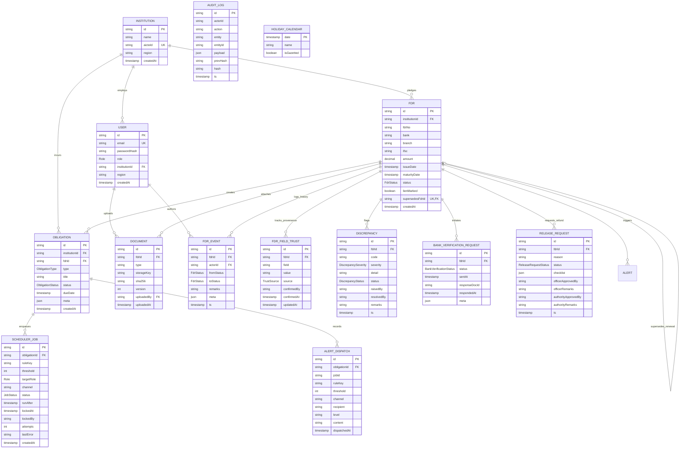

# ASTRA / FDR Vault — Data Model & Schema Specification

> **AICTE SIH26265**: Streamline Security Deposit / Fixed Deposit Receipt (FDR) Portal & Smart Automation  
> **Database Engine**: PostgreSQL 16 (with Row-Level Security)  
> **ORM Layer**: Prisma 5+

---

## 1. Entity-Relationship (ER) Diagram

The following Mermaid diagram maps the complete relational schema of the ASTRA platform, including institutional boundaries, FDR instruments, trust tracking, audit chains, and background scheduling.



---

## 2. Enumerated Domain Types (Enums)

| Enum Name | Valid Values | Description & Purpose |
| :--- | :--- | :--- |
| `Role` | `INSTITUTION`, `OFFICER`, `REGIONAL_OFFICER`, `AUTHORITY`, `BUREAU`, `COMMITTEE`, `ADMIN` | System authorization and access tier. |
| `FdrStatus` | `SUBMITTED`, `UNDER_SCRUTINY`, `DISCREPANCY`, `VERIFIED`, `ACTIVE`, `EXPIRING`, `RENEWED`, `LAPSED`, `RELEASE_REQUESTED`, `RELEASE_APPROVED`, `RELEASED` | 11-stage FDR lifecycle status machine. |
| `TrustSource` | `INSTITUTION`, `OFFICER_ENTERED`, `BANK_CONFIRMED` | Field-level provenance ledger state. |
| `DiscrepancySeverity`| `LOW`, `MEDIUM`, `HIGH` | Impact rating of automated compliance defect findings. |
| `DiscrepancyStatus`  | `OPEN`, `RESOLVED`, `WAIVED` | Resolution state of discrepancy items. |
| `BankVerificationStatus` | `PENDING`, `CONFIRMED`, `MISMATCH`, `NO_RESPONSE` | Status of issuing bank confirmation inquiry. |
| `ReleaseRequestStatus` | `PENDING_OFFICER`, `PENDING_AUTHORITY`, `APPROVED`, `REJECTED` | Status of two-tier refund clearance workflow. |
| `ObligationType` | `FDR_VALIDITY`, `STAGE_SLA`, `UNDERTAKING`, `LEASE_DOC` | Polymorphic compliance obligation category. |
| `ObligationStatus` | `PENDING`, `ACTIVE`, `FULFILLED`, `BREACHED`, `LAPSED` | Lifecycle state of a regulatory commitment. |
| `JobStatus` | `PENDING`, `PROCESSING`, `COMPLETED`, `FAILED` | State of asynchronous PostgreSQL job tasks. |

---

## 3. Relational Table Specifications

### 3.1. `Institution`
Represents an AICTE-approved technical institution (e.g., college, university department, or polytechnic).
- `id` (`String`, UUID PK): Unique institutional identifier.
- `name` (`String`): Official legal name of the institution.
- `aicteId` (`String`, Unique): Official AICTE permanent institute ID (e.g., `1-10972341`).
- `region` (`String`): Geographical AICTE jurisdiction (`NORTHERN`, `WESTERN`, `SOUTHERN`, `SOUTH_WESTERN`, `EASTERN`, `NORTH_WESTERN`, `CENTRAL`, `SOUTH_CENTRAL`).
- `createdAt` (`DateTime`): Timestamp of enrollment.

### 3.2. `User`
System actors with credentialed access.
- `id` (`String`, UUID PK): Actor UUID.
- `email` (`String`, Unique): Official user email address.
- `passwordHash` (`String`): Argon2id computational password hash.
- `role` (`Role`): Authorized role enum.
- `institutionId` (`String?`, FK ➔ `Institution.id`): Mandatory for `INSTITUTION` role; `NULL` for central officers.
- `region` (`String?`): Jurisdiction for `REGIONAL_OFFICER`; `NULL` for pan-India bureau roles.

### 3.3. `Fdr`
The central financial instrument entity pledged as a security deposit to AICTE.
- `id` (`String`, UUID PK): Instrument primary key.
- `institutionId` (`String`, FK ➔ `Institution.id`): Owning institution.
- `fdrNo` (`String`): Bank fixed deposit receipt number.
- `bank` (`String`): Issuing scheduled commercial bank name.
- `branch` (`String`): Issuing bank branch name.
- `ifsc` (`String`): 11-character RBI IFSC code.
- `amount` (`Decimal(14, 2)`): Deposit principal amount in INR.
- `issueDate` (`DateTime`): Deposit inception date.
- `maturityDate` (`DateTime`): Deposit contractual maturity date.
- `status` (`FdrStatus`): Current lifecycle state.
- `lienMarked` (`Boolean`): Flag indicating joint lien endorsed to AICTE.
- `supersedesFdrId` (`String?`, Unique, FK ➔ `Fdr.id`): Self-referencing link to previous FDR when renewed.
- Indexes:
  - `@@index([bank, fdrNo])`: Accelerated double-pledge duplicate checks.
  - `@@index([institutionId])`: Fast institution repository lookups.
  - `@@index([status])`: Scrutiny queue filtering.
  - `@@index([maturityDate])`: Expiry horizon scanning.

### 3.4. `FdrFieldTrust`
Tracks field-level provenance across 8 critical FDR attributes (`fdrNo`, `bank`, `branch`, `ifsc`, `amount`, `issueDate`, `maturityDate`, `lienMarked`).
- `id` (`String`, UUID PK): Primary key.
- `fdrId` (`String`, FK ➔ `Fdr.id`): Target FDR.
- `field` (`String`): Field attribute name.
- `value` (`String`): Raw stringified value.
- `source` (`TrustSource`): `INSTITUTION` (initial claim), `OFFICER_ENTERED` (manual edit), or `BANK_CONFIRMED` (verified against bank receipt/reply).
- `confirmedBy` (`String?`): User UUID or bank verification reference.
- `confirmedAt` (`DateTime?`): Timestamp of verification promotion.
- Constraint: `@@unique([fdrId, field])`.

### 3.5. `Document`
Files uploaded in support of an FDR (deposit receipts, lien letters, bank confirmations).
- `id` (`String`, UUID PK): Primary key.
- `fdrId` (`String`, FK ➔ `Fdr.id`): Parent FDR.
- `type` (`String`): Document category (`FDR_RECEIPT`, `JOINT_LIEN_LETTER`, `BANK_CONFIRMATION`, `AFFIDAVIT`).
- `storageKey` (`String`): Local or blob storage reference.
- `sha256` (`String`): Cryptographic digest of plaintext payload.
- `version` (`Int`): Version sequence counter.
- `uploadedBy` (`String`, FK ➔ `User.id`): Submitting actor.
- Indexes: `@@index([sha256])` for cross-institutional duplicate document re-use detection.

### 3.6. `FdrEvent`
Immutable state transition ledger documenting every lifecycle shift.
- `id` (`String`, UUID PK): Primary key.
- `fdrId` (`String`, FK ➔ `Fdr.id`): Target instrument.
- `actorId` (`String`, FK ➔ `User.id`): Acting user or system agent.
- `fromStatus` (`FdrStatus`): Origin status.
- `toStatus` (`FdrStatus`): Target status.
- `remarks` (`String?`): Required for reverts; optional for linear progressions.
- `meta` (`Json`): Contextual data (e.g., transition trigger, route template).
- `ts` (`DateTime`): Transition timestamp.

### 3.7. `AuditLog`
System-wide append-only cryptographic hash chain.
- `id` (`String`, UUID PK): Log record key.
- `actorId` (`String`): User or system caller.
- `action` (`String`): Action identifier (`FDR_CREATE`, `FDR_TRANSITION`, `FIELD_TRUST_PROMOTE`, `RELEASE_AUTHORIZE`).
- `entity` (`String`): Domain entity name (`Fdr`, `Document`, `ReleaseRequest`).
- `entityId` (`String`): Target entity UUID.
- `payload` (`Json`): Snapshot of modified fields.
- `prevHash` (`String`): SHA-256 hash of the immediate prior row ($64 \times \text{'0'}$ for genesis).
- `hash` (`String`): Computed SHA-256 hash across `prevHash + canonical_json(row)`.
- `ts` (`DateTime`): Timestamp.

### 3.8. `Obligation` & `SchedulerJob`
Polymorphic compliance register and PostgreSQL `FOR UPDATE SKIP LOCKED` worker queue.
- **Obligation**:
  - `id` (`String`, UUID PK)
  - `institutionId` (`String`, FK ➔ `Institution.id`)
  - `fdrId` (`String?`, FK ➔ `Fdr.id`)
  - `type` (`ObligationType`)
  - `title` (`String`)
  - `status` (`ObligationStatus`)
  - `dueDate` (`DateTime`)
  - `meta` (`Json`)
- **SchedulerJob**:
  - `id` (`String`, UUID PK)
  - `obligationId` (`String`, FK ➔ `Obligation.id`)
  - `ruleKey` (`String`): Threshold key (`T-90`, `T-60`, `T-30`, `T-7`, `T-0`, `T+N`).
  - `threshold` (`Int`): Days offset from due date.
  - `targetRole` (`Role`): Notified party.
  - `channel` (`String`): `IN_APP`, `SMTP`, `SMS`.
  - `status` (`JobStatus`): `PENDING`, `PROCESSING`, `COMPLETED`, `FAILED`.
  - `runAfter` (`DateTime`): Scheduled execution time.
  - `lockedAt` / `lockedBy` (`DateTime?`, `String?`): Concurrency lock state.
  - Constraint: `@@unique([obligationId, ruleKey, threshold])` prevents duplicate queue jobs.

---

## 4. PostgreSQL Row-Level Security (RLS) Policies

All multi-tenant queries pass through PostgreSQL Row-Level Security policies defined in `backend/prisma/rls.sql`:

```sql
-- 1. Enable RLS on core tables
ALTER TABLE "Fdr" ENABLE ROW LEVEL SECURITY;
ALTER TABLE "Document" ENABLE ROW LEVEL SECURITY;
ALTER TABLE "Obligation" ENABLE ROW LEVEL SECURITY;

-- 2. Institutional Isolation Policy:
-- Institutions can only read or mutate records belonging to their own institutionId
CREATE POLICY fdr_institution_isolation ON "Fdr"
    FOR ALL
    USING (
        current_setting('app.current_user_role', true) IN ('ADMIN', 'BUREAU', 'AUTHORITY', 'COMMITTEE')
        OR (
            current_setting('app.current_user_role', true) = 'INSTITUTION'
            AND "institutionId" = current_setting('app.current_user_institution_id', true)::uuid
        )
        OR (
            current_setting('app.current_user_role', true) IN ('OFFICER', 'REGIONAL_OFFICER')
            AND "institutionId" IN (
                SELECT id FROM "Institution" 
                WHERE region = current_setting('app.current_user_region', true)
            )
        )
    );
```
