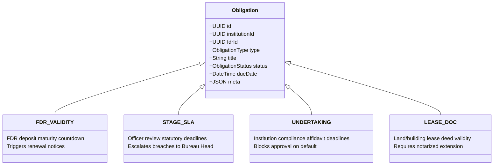
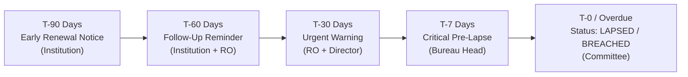

# ASTRA / FDR Vault — Unified Obligation Engine & Scheduler

> **AICTE SIH26265**: Streamline Security Deposit / Fixed Deposit Receipt (FDR) Portal & Smart Automation  
> **Source Code**: `backend/src/services/obligation-engine.ts`, `backend/src/services/job-queue.ts`, `backend/src/services/holiday-calendar.ts`, `backend/src/services/notifier.ts`  
> **Proving Tests**: `backend/test/obligation-scheduler.test.ts` (100% pass)

---

## 1. Problem Statement: Moving Beyond Fragmented Alerts

In conventional institutional management portals, alerts are built as ad-hoc cron jobs querying single tables. For instance, a script checks `Fdr.maturityDate`, another checks application submission dates, and a third checks land lease expiries. This fragmentation leads to:
1. **Notification Fatigue & Chaos**: Institutions receive uncoordinated emails from disparate subsystems.
2. **Missing SLA Oversight**: Regulatory stages (e.g. Scrutiny, EVC, Standing Appellate Committee) lack enforceable business-day deadline ladders.
3. **Queue Inconsistency**: External brokers (e.g. Celery/BullMQ with Redis) introduce two-phase commit issues where jobs dispatch even when the surrounding database transaction rolls back.

ASTRA resolves this via the **Unified Obligation Engine**: a single polymorphic compliance register governed by a transactionally consistent, database-native PostgreSQL job queue.

---

## 2. Polymorphic Obligation Types

Every regulatory commitment is encapsulated as an `Obligation` record:



| Obligation Type | Typical Target Entity | Statutory Default SLA | Escalation Target |
| :--- | :--- | :--- | :--- |
| `FDR_VALIDITY` | Pledged FDR Instrument | Contractual maturity date | Regional Officer & College Principal |
| `STAGE_SLA` | Scrutiny / EVC Review Stage | 15 working days | Regional Director & Bureau Head |
| `UNDERTAKING` | Institutional Affidavit / Land Deed | 30 calendar days from Deficiency Memo | Executive Committee |
| `LEASE_DOC` | Campus Land Lease Deed | 90 days prior to lease expiry | Legal Cell & Regional Officer |

---

## 3. Business-Day & Holiday-Aware Calendar

Deadlines for regulatory scrutiny cannot lapse on non-working days. ASTRA includes a dedicated `HolidayCalendar` service (`backend/src/services/holiday-calendar.ts`) seeded with gazetted national holidays:

```typescript
export function addWorkingDays(startDate: Date, days: number, holidays: Set<string>): Date {
  const current = new Date(startDate);
  let added = 0;
  while (added < days) {
    current.setDate(current.getDate() + 1);
    const dayOfWeek = current.getDay();
    const dateStr = current.toISOString().slice(0, 10);
    // Skip weekends (Sunday=0, Saturday=6) and Gazetted Holidays
    if (dayOfWeek !== 0 && dayOfWeek !== 6 && !holidays.has(dateStr)) {
      added++;
    }
  }
  return current;
}
```

---

## 4. The Standardized Alert Ladder

Each obligation automatically enqueues a progressive sequence of time-offset alerts:



| Threshold | Offset (Days) | Severity | Channel | Recipients | Automated System Action |
| :--- | :--- | :--- | :--- | :--- | :--- |
| `T-90` | $+90$ days | `INFO` | In-App, Email | Institution Signatory | Generates Renewal Guideline Packet |
| `T-60` | $+60$ days | `INFO` | In-App, Email | Institution, RO | Appends reminder to regional queue |
| `T-30` | $+30$ days | `WARNING` | In-App, Email | Institution, RO, Director | Status transitions to `EXPIRING` |
| `T-7` | $+7$ days | `CRITICAL` | In-App, Email, SMS | Institution, Bureau Authority | Prominent dashboard warning banner |
| `T-0` | $0$ days | `CRITICAL` | In-App, Email, SMS | All Stakeholders, Committee | Status auto-transitions to `LAPSED` |
| `T+N` | $-10$ days | `CRITICAL` | Formal Memo | Executive Committee | Added to statutory forfeit agenda |

---

## 5. PostgreSQL `SKIP LOCKED` Job Queue

Rather than requiring Redis, ASTRA leverages PostgreSQL 16's native concurrency primitive: `SELECT ... FOR UPDATE SKIP LOCKED`.

### 5.1. Concurrency Architecture
When multiple worker instances process the queue concurrently:
1. Worker A executes:
   ```sql
   SELECT id FROM "SchedulerJob"
   WHERE status = 'PENDING' AND "runAfter" <= NOW()
   ORDER BY "runAfter" ASC
   LIMIT 10
   FOR UPDATE SKIP LOCKED;
   ```
2. Worker B executes the exact same query concurrently; PostgreSQL instantly skips the rows locked by Worker A without blocking, giving Worker B the next 10 jobs.
3. This guarantees **zero lock contention** and **zero duplicate processing**.

### 5.2. Crash-Restart Idempotency Guarantee
If a worker node crashes midway through processing:
- The transaction automatically rolls back.
- Locked rows revert from `PROCESSING` to `PENDING`.
- When the worker restarts, it resumes cleanly.
- Unique constraints on `(obligationId, ruleKey, threshold)` prevent duplicate jobs from ever being inserted.

---

## 6. Multi-Channel Notification Dispatcher

The dispatcher (`backend/src/services/notifier.ts`) coordinates multi-channel delivery:
1. **In-App Alerts (`Alert` table)**: Real-time notification feed rendered in the top navbar and dashboard.
2. **SMTP Email**: Formatted transactional HTML emails sent via nodemailer to MailHog during development (port 1026) or production SMTP.
3. **SMS Gateway Stub**: Structured text payloads logged to stdout and recorded in `AlertDispatch` with ready-to-plug adapter for CDAC / NIC SMS gateways.
