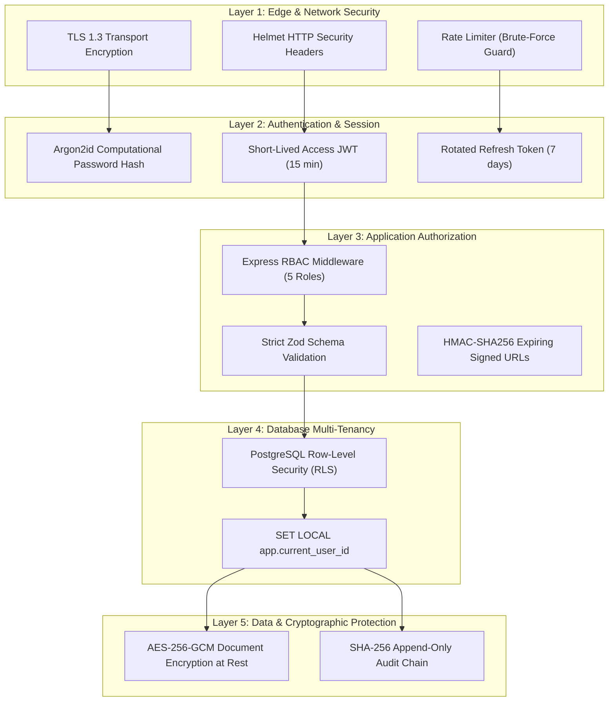

# ASTRA / FDR Vault — Security Architecture & Threat Matrix

> **AICTE SIH26265**: Streamline Security Deposit / Fixed Deposit Receipt (FDR) Portal & Smart Automation  
> **Classification**: Statutory Educational Compliance & Financial Integrity  
> **Source Code**: `backend/src/services/auth.ts`, `backend/src/services/storage.ts`, `backend/src/services/rls.ts`, `backend/prisma/rls.sql`

---

## 1. Executive Security Architecture

ASTRA is engineered according to **Defense-in-Depth** and **Least Privilege** principles to protect high-value institutional security deposits pledged to the All India Council for Technical Education.



---

## 2. Authentication & Credential Management

### 2.1. Password Hashing (Argon2id)
All user passwords are encrypted using **Argon2id** (the winner of the Password Hashing Competition), combining memory-hard computational resistance against GPU/ASIC cracking with side-channel attack protection:
- Algorithm: `Argon2id`
- Memory cost: $64 \text{ MB}$ ($65,536 \text{ KiB}$)
- Time iterations: $3$ passes
- Parallelism: $4$ threads

### 2.2. Token Lifecycle & Rotation
- **Access Tokens**: Ephemeral JSON Web Tokens signed with HMAC-SHA256 containing `userId`, `email`, `role`, `institutionId`, and `region`. Lifetime is capped at **15 minutes**.
- **Refresh Tokens**: Opaque, cryptographically random 64-character tokens stored in the database with a 7-day expiration. Upon each refresh request, the previous token is invalidated and a new one is issued (Refresh Token Rotation).

---

## 3. Role-Based Access Control (RBAC) Matrix

ASTRA implements 5 distinct operational roles to enforce separation of concerns across colleges, regional offices, central bureaus, and appellate committees:

| Action / Capability | `INSTITUTION` | `REGIONAL_OFFICER` | `BUREAU` | `COMMITTEE` | `ADMIN` |
| :--- | :---: | :---: | :---: | :---: | :---: |
| Submit New FDR Instrument | ✅ | ❌ | ❌ | ❌ | ❌ |
| View Own Institution FDRs | ✅ | ✅ (Jurisdiction) | ✅ (All) | ✅ (All) | ✅ (All) |
| View Other Institutions' FDRs | ❌ | ❌ (Cross-Region) | ✅ (All) | ✅ (All) | ✅ (All) |
| Perform Scrutiny & Edit Fields | ❌ | ✅ | ❌ | ❌ | ✅ |
| Revert with Deficiency Memo | ❌ | ✅ | ✅ | ❌ | ✅ |
| Resolve Discrepancy Flags | ❌ | ✅ (With Reason) | ✅ | ❌ | ✅ |
| Upload Bank Verification Memo | ❌ | ✅ | ✅ | ❌ | ✅ |
| Recommend FDR Release / Refund | ❌ | ✅ (5-Point Checklist)| ❌ | ❌ | ✅ |
| Authorize Final Release / Refund| ❌ | ❌ | ✅ | ❌ | ✅ |
| Access Committee Hearing Agenda | ❌ | ❌ | ✅ | ✅ | ✅ |
| Stream RFC 4180 CSV Data Export | ❌ | ✅ (Jurisdiction) | ✅ (All) | ✅ (All) | ✅ (All) |
| View Cryptographic Audit Chain | ❌ | ❌ | ✅ | ❌ | ✅ |
| Simulate Time-Travel Clock | ❌ | ❌ | ❌ | ❌ | ✅ |

---

## 4. PostgreSQL Row-Level Security (RLS)

Application-level guards can suffer from coding oversights (e.g. omitting a `WHERE institutionId = ...` clause). ASTRA backs all application controls with **kernel-level PostgreSQL Row-Level Security**:

1. **Session Propagation**: Before executing database operations, the application transaction sets local PostgreSQL session variables:
   ```sql
   SET LOCAL app.current_user_id = 'user-uuid';
   SET LOCAL app.current_user_role = 'INSTITUTION';
   SET LOCAL app.current_user_institution_id = 'inst-uuid';
   SET LOCAL app.current_user_region = 'NORTHERN';
   ```
2. **Zero-Leakage Enforcement**: Even if a raw SQL query `SELECT * FROM "Fdr"` is executed by an institutional session, PostgreSQL automatically filters out every row belonging to another college.
3. **Cross-Region Enforcement**: Regional Officers attempting to query records from other regions receive an empty result set (404 Not Found), verified by `backend/test/cross-region-rls.test.ts`.

---

## 5. Cryptographic Storage & Document Protection

### 5.1. Server-Side Document Encryption at Rest (AES-256-GCM)
All compliance files (deposit receipts, lien confirmation letters, affidavits) uploaded by institutions are encrypted before writing to persistent storage (`backend/src/services/storage.ts`):
- **Cipher**: `AES-256-GCM` (Galois/Counter Mode)
- **Initialization Vector (IV)**: Cryptographically random 12 bytes generated per file using `crypto.randomBytes(12)`.
- **Authentication Tag**: 16-byte GCM authentication tag verifying ciphertext authenticity.
- **Envelope Storage**: The 12-byte IV and 16-byte auth tag are stored alongside the ciphertext in local or S3 blob storage.
- **Digest Verification**: A plaintext SHA-256 digest is computed on upload to guarantee end-to-end file integrity and detect duplicate submissions across institutions.

### 5.2. Expiring HMAC-SHA256 Signed URLs
Direct file access via public URLs is prohibited. Files are retrieved through expiring signed tokens:
```typescript
const token = crypto
  .createHmac('sha256', JWT_SECRET)
  .update(`${documentId}:${expiresAt}`)
  .digest('hex');
```
Tokens expire after **15 minutes** and require a valid signature, preventing URL guessing or unauthorized hot-linking.

---

## 6. Cryptographic Audit Hash-Chain

To prevent administrators or database users from silently modifying records, all state shifts, field promotions, and release actions append to an immutable SHA-256 hash chain:
$$H_n = \text{SHA-256}\Big(H_{n-1} \parallel \mathcal{C}(R_n)\Big)$$
- Verified daily or on-demand via `GET /api/admin/audit/verify`.
- Any altered byte in historical rows or deleted record causes an immediate chain failure, identifying the exact record ID.

---

## 7. Threat Modeling & Countermeasures

| Threat Vector | Potential Impact | Implemented Mitigation |
| :--- | :--- | :--- |
| **Brute-Force Login Attacks** | Account takeover, credential stuffing | Express rate limiting (`express-rate-limit`) on `/api/auth/login`, Argon2id computational delay. |
| **SQL Injection (SQLi)** | Data exfiltration, privilege escalation | Parameterized queries via Prisma ORM; zero string interpolation in SQL queries. |
| **Cross-Tenant Data Leakage** | Institution views rival's financial deposits | Double-layer isolation: Zod/Express route scoping AND PostgreSQL Row-Level Security. |
| **Document Forgery / Re-use** | Institution uses same receipt for two colleges | Automated rules engine checks SHA-256 document collision across all institutions (`DUPLICATE_DOCUMENT_HASH`). |
| **Rogue Officer FDR Approval** | Invalid deposit activated without bank check | State machine blocks `ACTIVE` transition if open discrepancies exist; requires `BANK_CONFIRMED` field trust. |
| **Unauthorized Fund Release** | Premature refund of security deposit | Two-tier release gating: RO sign-off on 5-point checklist followed by Bureau Authority sign-off. |
