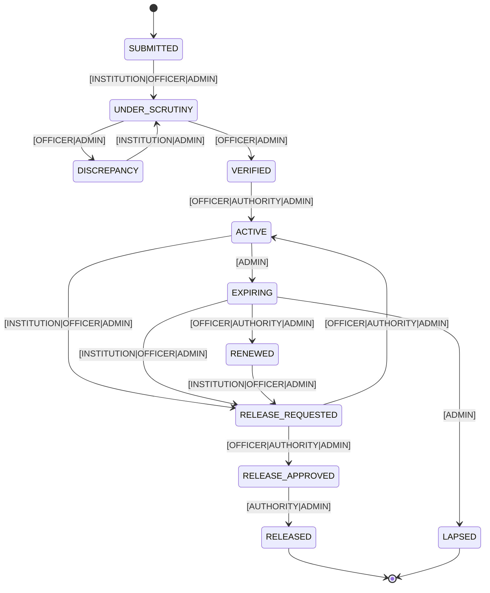

# FDR State Machine

Generated automatically from `packages/shared/src/state-machine.ts`. Do not edit manually.

## Mermaid Flow Diagram



## ASCII Flow Diagram
```text
+-----------------------------------------------------------------------------------------+
|                                  FDR LIFECYCLE FLOW                                      |
+-----------------------------------------------------------------------------------------+
 [SUBMITTED] 
      │ (auto/INSTITUTION/OFFICER)
      ▼
 [UNDER_SCRUTINY] <--------+ (INSTITUTION resubmits)
      │                    |
      ├─(OFFICER flags)──> [DISCREPANCY]
      ▼ (OFFICER verifies)
  [VERIFIED]
      │ (OFFICER/AUTHORITY accepts)
      ▼
   [ACTIVE] ─────────────────────+ (T-90 Clock Engine)
      │                          ▼
      │                     [EXPIRING] ───(Matured no renewal)───> [LAPSED]
      │                          │
      │                          ├─(Replacement reaches ACTIVE)──> [RENEWED]
      ▼                          ▼                                    │
 [RELEASE_REQUESTED] <───────────┴────────────────────────────────────┘
      │
      ├─(OFFICER rejects)────────> [ACTIVE]
      ▼ (OFFICER recommends)
 [RELEASE_APPROVED]
      │ (AUTHORITY signs off)
      ▼
  [RELEASED]
```


## Transition Specifications
| From | To | Allowed Roles | Description | Guard Logic |
| :--- | :--- | :--- | :--- | :--- |
| `SUBMITTED` | `UNDER_SCRUTINY` | `INSTITUTION, OFFICER, ADMIN` | FDR moves to scrutiny queue after submission | None |
| `UNDER_SCRUTINY` | `DISCREPANCY` | `OFFICER, ADMIN` | Officer flags discrepancy requiring institution attention | None |
| `DISCREPANCY` | `UNDER_SCRUTINY` | `INSTITUTION, ADMIN` | Institution submits corrections/explanations for scrutiny | None |
| `UNDER_SCRUTINY` | `VERIFIED` | `OFFICER, ADMIN` | Officer marks FDR verified after bank confirmation received and no open high discrepancies | Conditional Guard |
| `VERIFIED` | `ACTIVE` | `OFFICER, AUTHORITY, ADMIN` | FDR is formally accepted as active security deposit | None |
| `ACTIVE` | `EXPIRING` | `ADMIN` | FDR reaches T-90 deadline window before maturity | None |
| `EXPIRING` | `RENEWED` | `OFFICER, AUTHORITY, ADMIN` | Linked replacement FDR reaches ACTIVE status | None |
| `EXPIRING` | `LAPSED` | `ADMIN` | Maturity date passed without active replacement FDR | None |
| `ACTIVE` | `RELEASE_REQUESTED` | `INSTITUTION, OFFICER, ADMIN` | Institution requests release of active FDR | Conditional Guard |
| `EXPIRING` | `RELEASE_REQUESTED` | `INSTITUTION, OFFICER, ADMIN` | Institution requests release of expiring FDR | None |
| `RENEWED` | `RELEASE_REQUESTED` | `INSTITUTION, OFFICER, ADMIN` | Institution requests release of superseded renewed FDR | None |
| `RELEASE_REQUESTED` | `RELEASE_APPROVED` | `OFFICER, AUTHORITY, ADMIN` | Officer provides first-level recommendation and checklist clearance | Conditional Guard |
| `RELEASE_APPROVED` | `RELEASED` | `AUTHORITY, ADMIN` | Competent authority grants final release/refund approval | None |
| `RELEASE_REQUESTED` | `ACTIVE` | `OFFICER, AUTHORITY, ADMIN` | Release request rejected, restoring FDR to active status | None |
