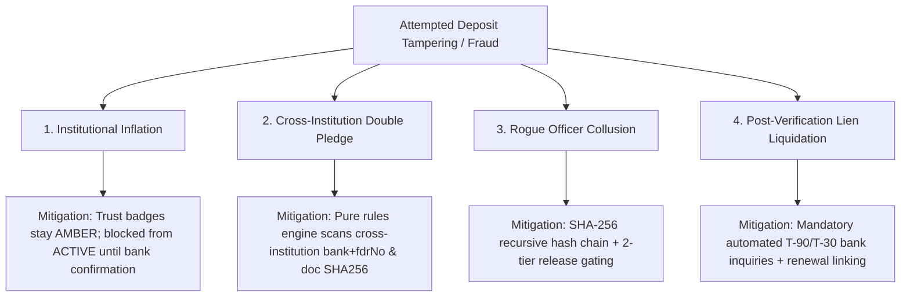

# ASTRA / FDR Vault — Trust Model & Field-Level Provenance Ledger

> **AICTE SIH26265**: Streamline Security Deposit / Fixed Deposit Receipt (FDR) Portal & Smart Automation  
> **Core Concept**: Claimed-vs-Verified Trust Provenance Architecture  
> **Source Code**: `backend/src/services/trust.ts`, `backend/src/services/bank-verifier.ts`

---

## 1. Problem Definition: The Trust Gap in Educational Compliance

In traditional regulatory portals, when an institution enters a Fixed Deposit Receipt (e.g. ₹35,00,000 at State Bank of India), the entire record is stored as a single flat row. If an officer corrects a typo or verifies a document, the previous assertion is overwritten, erasing the distinction between **what the college asserted** and **what the bank confirmed**.

This creates serious systemic vulnerabilities:
1. **Collusive Inflation**: An institution claims ₹35 Lakhs while uploading a ₹3.5 Lakh receipt; an overworked officer approves the high-level form without itemized proof.
2. **Untracked Alteration**: Officer adjustments to interest or maturity dates cannot be distinguished from institutional fraud.
3. **Ghost FDRs**: Instruments pledged to AICTE are liquidated or lien-removed at the branch without regulator awareness.

ASTRA eliminates these vulnerabilities by replacing flat record storage with a **Field-Level Provenance Ledger** (`FdrFieldTrust`).

---

## 2. The Tri-State Trust Hierarchy

Every critical attribute of an FDR is assigned an independent trust provenance tag:

```mermaid
stateDiagram-v2
    [*] --> INSTITUTION: Institution Submits FDR (POST /api/fdrs)
    
    INSTITUTION --> OFFICER_ENTERED: Officer Rectifies Field During Scrutiny
    INSTITUTION --> BANK_CONFIRMED: Bank Verification Upload / Confirmation
    OFFICER_ENTERED --> BANK_CONFIRMED: Bank Verification Upload / Confirmation

    state INSTITUTION {
        description: Amber Badge - Unverified self-reported institutional claim
    }
    state OFFICER_ENTERED {
        description: Blue Badge - Scrutiny officer entered or corrected field with justification
    }
    state BANK_CONFIRMED {
        description: Teal Badge - Apex Trust confirmed directly by bank receipt / signed reply
    }
```

### 2.1. Trust State Definitions

| Trust State | UI Badge | Authority Level | Description |
| :--- | :--- | :--- | :--- |
| `INSTITUTION` | 🟡 Amber (`CLAIMED`) | Baseline (Unverified) | The field value was submitted directly by the college principal or authorized institutional signatory. Treated as an unverified legal claim. |
| `OFFICER_ENTERED` | 🔵 Blue (`OFFICER VERIFIED`) | Medium (Administrative) | A Regional Scrutiny Officer modified or affirmed the field during formal review, attaching justification remarks to the audit trail. |
| `BANK_CONFIRMED` | 🟢 Teal (`BANK CONFIRMED`) | Apex (Independent) | The field has been verified against an official bank document, signed confirmation reply, or Core Banking System (CBS) inquiry. |

### 2.2. Tracked Critical Fields
The trust ledger tracks 8 critical fields per instrument:
1. `fdrNo`: Unique instrument number.
2. `bank`: Name of the scheduled commercial bank.
3. `branch`: Originating branch location.
4. `ifsc`: RBI branch IFSC code.
5. `amount`: Principal deposit amount.
6. `issueDate`: Date of initial placement.
7. `maturityDate`: Expiry/maturity date.
8. `lienMarked`: Statutory joint lien endorsement to Member Secretary, AICTE.

---

## 3. Promotion Lifecycles & State Transitions

### 3.1. Initialization on Ingestion
When an FDR is created via `POST /api/fdrs`, the backend transaction initializes all 8 entries in `FdrFieldTrust` with `source = 'INSTITUTION'`:
```typescript
await tx.fdrFieldTrust.createMany({
  data: trackedFields.map(field => ({
    fdrId: fdr.id,
    field: field.name,
    value: String(field.value),
    source: 'INSTITUTION',
    confirmedBy: actorId,
    confirmedAt: Clock.now()
  }))
});
```

### 3.2. Scrutiny Rectification (`OFFICER_ENTERED`)
If a Regional Officer observes that the institution entered ₹35,00,000 but the attached scan shows ₹3,50,000, the officer updates the field via the scrutiny console. The system:
1. Records `source = 'OFFICER_ENTERED'`.
2. Records `confirmedBy = officerUser.id`.
3. Appends an entry to the cryptographic audit hash chain with the officer's written remarks.

### 3.3. Bank Confirmation (`BANK_CONFIRMED`)
When the issuing bank responds to the formal AICTE lien verification letter:
1. The officer uploads the bank's signed verification memo (`POST /api/bank/verify`).
2. The system executes `promoteFieldTrust(fdrId, field, 'BANK_CONFIRMED', officerId, tx)`.
3. The trust badge permanently flips to `BANK_CONFIRMED`.
4. Only with all critical fields at `BANK_CONFIRMED` or officer-cleared status can the FDR proceed to `ACTIVE`.

---

## 4. Threat Matrix & Tampering Attack Tree



### 4.1. Detailed Attack Vectors & Countermeasures

#### Attack 1: Fabricated Bank FDR Number
- **Vector**: College submits a fictitious FDR number or reuses an old cancelled receipt.
- **Countermeasure**: The automated rules engine checks for cross-institutional duplicate FDR numbers (`DUPLICATE_FDR_NO`) and identical document file digests (`DUPLICATE_DOCUMENT_HASH`). Furthermore, status cannot advance beyond `UNDER_SCRUTINY` without positive bank confirmation.

#### Attack 2: Officer Collusion
- **Vector**: A compromised regional officer attempts to quietly mark an invalid FDR as `ACTIVE` or delete records of a deficiency.
- **Countermeasure**: Every mutation appends a block to `AuditLog` containing the prior row's SHA-256 hash. Deleting or modifying any audit row breaks the chain. The daily integrity verification job (`GET /api/admin/audit/verify`) detects the exact breakpoint.

#### Attack 3: Unauthorized Deposit Liquidation
- **Vector**: College approaches the bank branch directly to prematurely close the deposit without AICTE knowledge.
- **Countermeasure**: The formal bank verification process requires the bank manager to return a signed lien acknowledgment letter pledging that the deposit cannot be liquidated, transferred, or encumbered without formal written authorization signed by the Bureau Authority of AICTE.

---

## 5. Bank Verification Gateway

Because Indian commercial banks do not yet expose standardized open APIs for third-party lien confirmation, ASTRA provides a practical, production-ready gateway:

1. **Formal Inquiry Generation**: The system generates a standardized AICTE inquiry letter with a unique reference token and barcoded verification link.
2. **Dual-Mode Response Ingestion**:
   - **Production Mode**: Regional Officer uploads the bank's stamped, signed reply memo. The document digest is stored, and fields are promoted.
   - **Interactive Demonstration Mode**: A simulated mock verification toggle (`POST /api/bank/mock-verify`) allows evaluators to simulate instant bank confirmation for testing lifecycle transitions.
